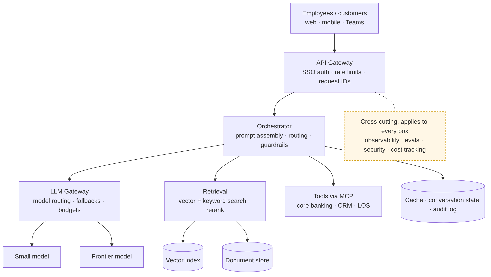

# Ep 1 — The AI System Design Interview Playbook

**Release:** Sat 31 Oct 2026
**Interview question:** *"Walk me through how you'd approach any AI system design question."*
**Northwind demand:** Priya (CDO): "We want an AI assistant for 9,000 employees. Before anyone builds anything, tell me how you'll design it and what it'll cost."

## What you'll learn

- The 9-step framework for any AI system design answer ([framework/playbook.md](../framework/playbook.md))
- The five ways AI system design differs from classic system design
- How to estimate traffic, tokens and monthly cost in 4 minutes
- The generic reference architecture every later episode builds on
- What separates a 3/10 answer from an 8/10 answer ([framework/rubric.md](../framework/rubric.md))

## Five ways AI system design is different

| Classic system design | AI system design adds… |
| --- | --- |
| Deterministic outputs, unit-testable | Probabilistic outputs → **evals** and golden datasets |
| Cost scales with servers | Cost scales with **tokens** → cost is a requirement |
| Correctness is binary | **Quality** must be defined (grounded? cited? complete?) |
| Data sits in databases | Data flows **into prompts** → PII, residency, access control on context |
| Attack surface: APIs, auth | **Prompt injection** through documents, emails, tool outputs |

## Estimates (Northwind assistant)

From [northwind/assumptions.md](../northwind/assumptions.md), reproducible with `python tools/cost_estimator.py --compare --route small=0.7,large=0.3`:

| Quantity | Value |
| --- | --- |
| Questions/day | 9,000 × 30% × 4 = 10,800 |
| Average peak QPS | 0.45 → design for ~5 QPS |
| Tokens per question | 2,850 in / 300 out |
| Cost/month, small tier | ~$144 |
| Cost/month, frontier tier | ~$3,101 |
| Cost/month, routed 70/30 | ~$1,031 |

*Prices are illustrative tiers. Check current list prices before quoting them.*

## Reference architecture

Source: [diagrams/reference-architecture.mmd](diagrams/reference-architecture.mmd)

## Interviewer follow-ups — model answers

**1. How would you estimate cost before building anything?**
Work back from usage: users × active share × queries per user gives volume; a prompt template gives tokens per request (system + history + k × chunk size + question, plus output). Multiply by current list prices for two or three candidate tiers. Then run a 1-day pilot with real users and replace every assumption with a measured number: actual questions per user, actual output length. The estimate's job is to choose the architecture, not to be exact.

**2. Which requirements are unique to AI systems?**
Answer quality and how it's judged; hallucination tolerance; grounding and citations; cost per request or per task; context/token budget; data sensitivity of what goes into prompts; freshness; explainability and audit; and handling non-determinism in testing. Naming three of these unprompted signals seniority.

**3. When would you not use an LLM?**
Lookups (balances, statuses): call the system of record. Calibrated risk decisions (fraud, credit): classic ML, with an LLM only to explain. Fixed rules (eligibility): a rules engine. Hard sub-100 ms latency at high volume: keep the LLM off the hot path. In a bank, the LLM usually assists a human; it rarely decides.

**4. How do you define a "good answer" up front?**
Write 30–50 real questions with the expected answer and the source document *before* building. Define pass criteria: correct, grounded in the cited source, complete enough to act on, and refuses when the answer isn't in the corpus. These become the golden set that gates every change (Ep 10).

**5. How do you set a latency budget?**
Start from the user experience: chat users judge speed by time to first token, so target TTFT under ~1.5 s and stream the rest. Split the budget by stage (gateway, embedding, search, rerank, model) and give each a p95 target. Whatever stage blows its budget is where caching, smaller models or parallelism go first (Ep 8).

## Design challenge

Northwind's US subsidiary has **1,500 employees, 40% daily active, 6 questions/day**, and wants **8 chunks** of context per answer. Estimate the monthly cost on the mid tier and post your working in the comments.

## Files

| File | Purpose |
| --- | --- |
| `cheatsheet.pdf` / `cheatsheet.md` | One-page playbook |
| `diagrams/` | Mermaid source + PNG |
| `demo/` | Token counter + cost estimate walkthrough; `backup_output.txt` shows the expected output |
