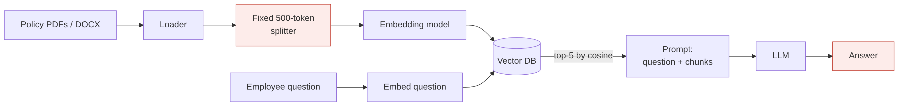
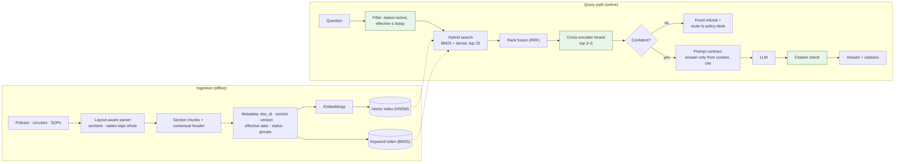

# Ep 2 — Design a Bank's Policy Q&A Bot (RAG from First Principles)

**Release:** Wed 4 Nov 2026
**Interview question:** *"Design a chatbot that answers employee questions over 50,000 internal documents."*
**Northwind demand:** Meera (Head of Retail Lending): "My branch staff spend 20 minutes hunting through circulars for one answer. And last month someone quoted a withdrawn policy to a customer."

## Requirements

| Type | Requirement |
| --- | --- |
| Functional | Natural-language Q&A over policies, circulars, SOPs; cites document + section; says "I don't know" when the answer isn't there; multi-turn follow-ups |
| Non-functional | p95 time-to-first-token < 2 s; ~5 QPS design load; 99.9% availability in business hours |
| AI-specific | Grounded answers only (no outside knowledge); **only the current version** of a policy; faithfulness ≥ 0.9 on the golden set; refusal on unanswerable questions |
| Out of scope (Ep 3) | Per-user document permissions, real-time freshness |

## Estimates

| Quantity | Value | Working |
| --- | --- | --- |
| Corpus | 400,000 pages ≈ 200M tokens | 50,000 docs × 8 pages × 500 tokens |
| Chunks | ~444,000 | 200M ÷ (500 − 50 overlap) |
| Raw vectors | ~1.8 GB | 444k × 1,024 dims × 4 bytes |
| With index + payload | plan ~4 GB | HNSW graph + metadata |
| One-time embedding | ~$4 | 200M × $0.02/1M (illustrative) |
| Per question | 2,850 in / 300 out tokens | see Ep 1 |

**Teaching point:** embedding the whole corpus costs less than a coffee. The recurring cost is the LLM call, and its size is set by how many chunks you retrieve.

## v1 — the naive pipeline



Load → split into fixed 500-token chunks → embed → vector DB → top-5 by cosine → prompt → LLM.

## Break it

| Failure | Why v1 fails |
| --- | --- |
| "What's the FOIR for self-employed?" returns the wrong section | Acronyms, product codes and amounts are exact-match terms; embeddings blur them |
| A table of LTV caps is split mid-row | Fixed-size chunking ignores document structure |
| Bot quotes the 0.5% penalty from the **superseded** v2 policy | Nothing in the index knows which version is current |
| "Crypto custody policy?" → confident made-up answer | No refusal path; the model fills gaps |

## v2 — the design you defend



1. **Structure-aware chunking:** split on headings/sections; keep tables whole; prepend a contextual header (document title + section) to every chunk; 300–800 tokens.
2. **Metadata on every chunk:** doc_id, section, version, effective date, status (active/superseded), owner, access groups (used in Ep 3).
3. **Hybrid retrieval:** BM25 (exact terms) + dense vectors (meaning), merged with Reciprocal Rank Fusion, retrieving the top 20.
4. **Filter before ranking:** `status = active AND effective_date <= today`.
5. **Rerank** the top 20 with a cross-encoder down to the best 3–5 (precision at low token cost).
6. **Prompt contract:** answer only from context, cite `[doc §section]`, fixed refusal sentence.
7. **Answer check:** reject answers whose citations don't match retrieved chunks.

## Trade-offs

| Decision | Chosen | Alternative | Why |
| --- | --- | --- | --- |
| Retrieval | Hybrid BM25 + dense | Dense only | Banking text is full of codes, acronyms and amounts |
| Chunking | Section-aware + header | Fixed 500 tokens | Policies have strong structure; tables must stay whole |
| Context size | 3–5 reranked chunks | 20 raw chunks | ~4× fewer input tokens, less noise for the model |
| Vector store | pgvector (already run Postgres) or Qdrant | Managed SaaS DB | Data residency, existing ops skills; 4 GB is small |
| Index type | HNSW | IVF / flat | Fast and accurate at this size; memory is affordable |
| Versioning | Filter on status/effective date | Delete old versions | Audit needs history; filtering keeps it queryable |

## Demo

`demo/rag_demo.py` compares dense vs keyword vs hybrid vs hybrid+filter on the golden set, and prints the grounded prompt. It runs offline; set `LLM_BASE_URL/LLM_API_KEY/LLM_MODEL` (Groq or Ollama) to generate answers.

```
python demo/rag_demo.py
python demo/rag_demo.py --ask "Can a senior citizen break a 2-year FD early without penalty?" --llm
```

## Interviewer follow-ups — model answers

**1. How did you choose chunk size?** Start from structure: one section per chunk where sections are 300–800 tokens; split longer sections on paragraphs with ~10% overlap. Then tune empirically: measure recall@k and faithfulness on the golden set for 2–3 sizes. Smaller chunks give precise retrieval but lose context; larger chunks cost tokens and dilute relevance.

**2. When is hybrid search worth it?** Whenever users search for exact identifiers: product codes, acronyms, amounts, section numbers, names. That covers almost every enterprise corpus. Its cost is a keyword index and a fusion step, which is cheap. Measure it: if hybrid doesn't beat dense on your golden set, drop it.

**3. HNSW vs IVF?** HNSW gives high recall and low latency at the price of memory; it is ideal up to tens of millions of vectors. IVF (optionally with product quantization) trades some recall for much lower memory at hundreds of millions of vectors. At 444k vectors, HNSW is the obvious choice.

**4. How do you handle tables?** Keep each table in one chunk, converted to Markdown so row/column relationships survive. Add a one-line summary of the table to the chunk header. For very large tables, chunk by row groups and repeat the header row in every chunk.

**5. How does the bot refuse safely?** Three layers: retrieval confidence (if the best reranker score is below a threshold, skip the LLM and refuse); a prompt contract with a fixed refusal sentence; and a post-check that every citation maps to a retrieved chunk. Track the refusal rate: too high means retrieval is failing, too low on unanswerable golden questions means the bot is hallucinating.

## Design challenge
Northwind's credit policy manual is 300 pages with 40 tables, nested numbering (5.3.2.1) and annexures that override main sections. Propose a chunking strategy, with your metadata fields. Post it in the comments.
