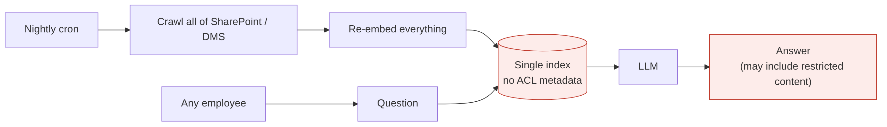
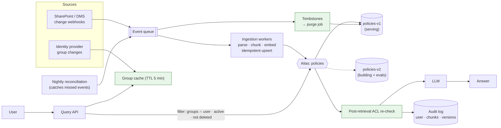

# Ep 3 — Permission-Aware RAG at Scale: Ingestion, Freshness, Access Control

**Release:** Sat 7 Nov 2026
**Interview question:** *"How do you keep a RAG system fresh, and stop it leaking documents a user isn't allowed to see?"*
**Northwind demand:** Daniel (CISO): "An intern asked the bot about director pay and got an answer. Fix it this week. And HR withdrew a policy on Monday that the bot was still quoting on Thursday."

## Requirements

| Type | Requirement |
| --- | --- |
| Security | A user can only ever retrieve chunks they could open in the source system (SharePoint/DMS) |
| Freshness | New/changed documents answerable within **15 minutes**; deletions effective within **5 minutes** |
| Access changes | Joiner/mover/leaver changes reflected within **15 minutes**, without re-indexing |
| Operability | Re-chunking or changing the embedding model with **zero downtime** and instant rollback |
| Audit | Every answer logs which chunks (and versions) were shown to which user |

## Estimates

| Quantity | Value |
| --- | --- |
| Daily change | 1% of 50,000 docs = 500 docs/day ≈ 2M tokens |
| Re-embedding cost | ≈ $0.04/day (illustrative) |
| Change events | ~500 doc events + ~200 IdP group changes/day: tiny throughput, but they **must not be lost** |
| Full rebuild | 200M tokens; with 8 parallel embedding workers at ~25k tokens/s each, ≈ 17 min (measure yours) |

Conclusion: freshness is not a throughput problem; it's a **correctness and event-handling** problem.

## v1 → break it

Nightly batch: crawl everything, re-embed everything, one index, no ACLs.

| Failure | Root cause |
| --- | --- |
| Intern sees director pay bands | No ACL metadata on chunks; retrieval ignores identity |
| Withdrawn policy still cited 3 days later | Deletions only picked up by the nightly crawl, and the crawl failed twice |
| Re-index takes 9 hours and blocks changes | Full rebuild in place; no incremental path |
| Moved employee still sees old department's docs | ACLs copied as user lists at index time, so they go stale |

## v2 — event-driven, permission-aware

1. **Events, not crawls:** source webhooks / change feeds (SharePoint, DMS) → queue (Kafka / SQS / Service Bus) → ingestion workers. A nightly **reconciliation** job catches missed events.
2. **Idempotent upserts** keyed by `doc_id + version`; chunk IDs are deterministic, so replays are safe.
3. **Store groups, not users:** each chunk carries the source document's ACL as *group IDs*. User → groups is resolved **at query time** from the IdP (cached ~5 min). A mover's access changes when their groups change, with no re-index.
4. **Pre-filter inside the vector search** (`groups ∩ user_groups ≠ ∅ AND status = active AND not deleted`). Post-filtering can starve results and is error-prone.
5. **Tombstones for deletes:** a delete event writes a tombstone that is filtered immediately; a purge job removes vectors later.
6. **Blue-green indexes behind an alias:** build `policies-v2`, run golden-set evals, then flip the alias atomically; keep v1 for rollback.
7. **Defence in depth:** a post-retrieval check re-verifies ACLs on the final chunks, and the audit log records `user, chunk_ids, versions`.

## Trade-offs

| Decision | Chosen | Alternative | Why |
| --- | --- | --- | --- |
| ACL model | Group IDs on chunks, groups resolved at query time | User lists on chunks | Movers/leavers don't require re-indexing |
| Filtering | Pre-filter in the vector query | Post-filter | Guarantees k results and no forbidden chunk ever leaves the DB |
| Freshness | Event-driven + nightly reconciliation | Nightly batch only | Minutes, not days; reconciliation covers lost events |
| Deletes | Tombstone now, purge later | Synchronous hard delete | Instant effect, cheap, auditable |
| Re-index | Blue-green alias | Rebuild in place | Zero downtime, instant rollback |
| Index topology | One index + filter | Index per department | Simpler; per-tenant indexes only for hard isolation (e.g., India vs US residency) |

**Data residency note:** Indian and US documents go to **separate indexes in their own regions**; the router picks the index by the user's home entity. That's hard isolation, not a filter.

## Demo
`python demo/acl_rag.py` plays five scenes: the leak, pre- vs post-filtering, an IdP group change, a tombstone delete, and a blue-green alias swap.

## Interviewer follow-ups — model answers

**1. Pre-filter or post-filter?** Pre-filter, inside the vector DB query, using a payload/metadata filter. Post-filtering retrieves top-k and then drops forbidden chunks, so a user may get 1 result instead of 5, and a bug in the filter leaks data. Most vector DBs (Qdrant, pgvector with WHERE, OpenSearch, Weaviate) support filtered ANN search; check its recall with restrictive filters.

**2. How do ACL changes propagate?** Keep ACLs as group IDs on chunks and resolve a user's groups from the IdP at query time with a short-TTL cache. Group membership changes then take effect within the cache TTL. If a *document's* ACL changes, the source emits a permission-change event and only that document's chunk metadata is updated, with no re-embedding.

**3. Zero-downtime re-indexing?** Build a new index in parallel (new chunking or embedding model), backfill it, replay events that arrived during the build, run the golden-set evals, then switch an alias. Keep the old index for rollback until the new one has run cleanly in production for a while.

**4. How do you avoid duplicates?** Deterministic IDs (`doc_id#version#section`), upsert semantics, and content hashes so that unchanged sections are skipped on re-ingest. Near-duplicate documents (the same circular in two folders) are de-duplicated by hash at ingest, with both sources kept in metadata.

**5. Right to erasure / legal deletion?** Tombstone immediately; purge vectors, chunks, caches *and* any semantic-cache entries built from that document; record the deletion in the audit log. Prove it with a test that queries for the deleted content after purge.

## Design challenge
Ravi moves from Retail Banking to Treasury on Monday at 9 AM. List every system event and component involved so that by 9:15 he can read Treasury SOPs and can no longer read Retail-only circulars.
