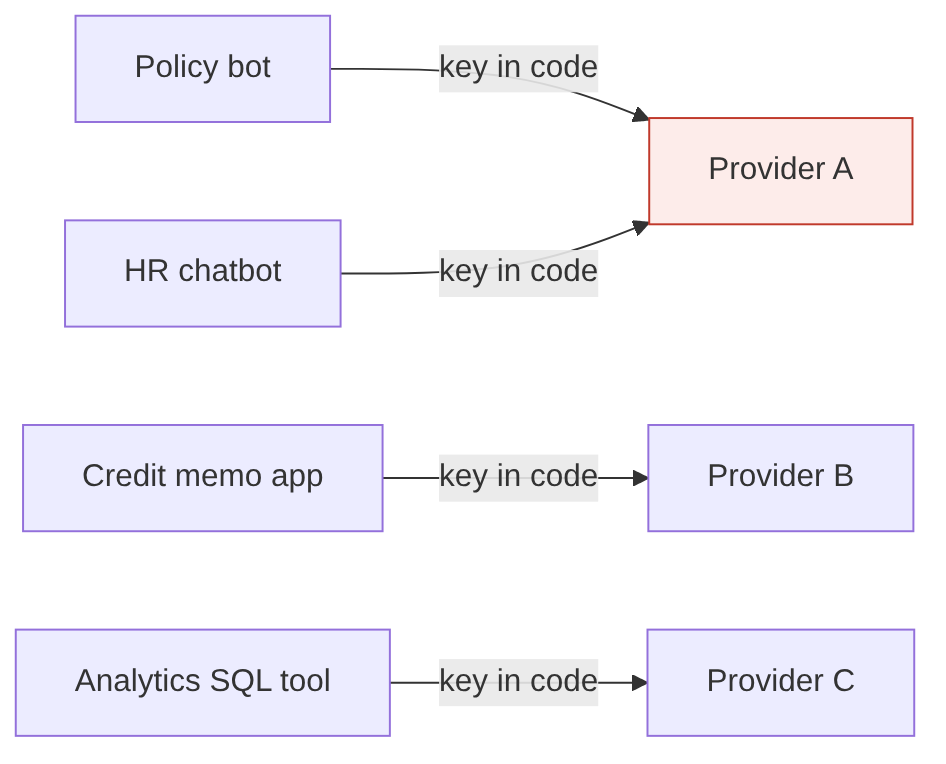
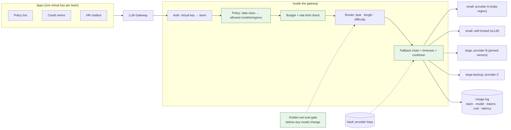

# Ep 4 — Design an LLM Gateway: Model Selection, Routing, Fallbacks, Cost per Answer

**Release:** Sun 8 Nov 2026
**Interview question:** *"How would you choose and route between multiple LLMs in an enterprise?"*
**Northwind demand:** Arjun (Platform): "Five teams now call three AI providers directly with keys in their code. One team spent a month's budget in nine days, and when a provider went down on Tuesday, everything went down with it."

## Requirements

| Type | Requirement |
| --- | --- |
| Functional | One API for all teams; logical model names (`small`, `large`); routing by task; fallbacks; per-team keys, quotas and budgets |
| Non-functional | Adds < 30 ms p95; 99.95% available (more than any single provider); horizontally scalable |
| Governance | Only approved models; Indian data → India-region endpoints; every call logged (team, model, tokens, cost, latency) without storing raw PII |
| Change safety | Model version pinned; a new model goes live only after passing the golden-set eval |

## Estimates

| | Value |
| --- | --- |
| Gateway QPS | ~5 QPS policy bot + ~2 QPS other apps → design for 20 QPS burst; trivial for a stateless proxy |
| Cost, all frontier | $3,101/month for the policy bot alone (Ep 1) |
| Cost, routed 70/30 | ~$1,031/month: **saves ~$2,070/month (≈ ₹1.8 lakh)** |
| Availability | One provider at 99.5% → ~3.6 h down/month. Two independent providers as fallback → 1 − 0.005² ≈ 99.9975% for the LLM layer |

## Model selection criteria (in order)

1. **Can it do the task?** Measured on *your* golden set, not leaderboards
2. **Data constraints:** residency, retention, training-on-data terms, private endpoints
3. **Latency** (TTFT and tokens/s) at your prompt size
4. **Cost** per answer or per task, not per token
5. **Context window** vs your prompt budget
6. **Operational:** rate limits, SLAs, regions, version stability, support

## v1 → break it



| Failure | Root cause |
| --- | --- |
| Provider outage = total outage | Hard-coded single provider |
| One team burns the budget in 9 days | No per-team quotas, no visibility |
| A silent model update breaks prompts | Unpinned "latest" model alias |
| Keys leaked in a repo | Provider keys in app code |
| Nobody can answer "what did AI cost Retail last month?" | No central logging |

## v2 — the gateway



- **One endpoint, logical models:** apps ask for `small` / `large` / `embed`; the gateway maps them to pinned provider versions.
- **Router:** rules first (task type, prompt length, data classification), optionally a small classifier for difficulty. Escalate to `large` only when needed.
- **Fallback chain** per logical model, with **timeouts** and a **cooldown** for failing deployments (a full circuit breaker comes in Ep 9).
- **Virtual keys per team** with budgets, rate limits and allowed models; provider keys live only in the vault.
- **Policy enforcement:** data classification → allowed regions/models (Indian customer data → India-region endpoints only).
- **Logging:** team, use case, model, tokens, cost, latency, request ID; prompts stored **redacted** or not at all.
- **Change gate:** a new model version runs the golden set in shadow mode before the alias moves.

## Self-host or API?

Self-host (e.g. vLLM on your GPUs) when: data can't leave your network; sustained volume keeps GPUs busy (> ~50–60% utilisation); or you need a fine-tuned open model. Otherwise APIs win on quality per rupee, zero ops and elasticity. **Break-even:** monthly GPU cost (instances + ops people) ÷ API cost per million tokens = the token volume at which self-hosting pays off. Do the arithmetic with today's prices and *include the engineers*.

## Trade-offs

| Decision | Chosen | Alternative | Why |
| --- | --- | --- | --- |
| Gateway | Central gateway (LiteLLM proxy / cloud AI gateway) | SDK wrapper in each app | One place for keys, budgets, logs, policy |
| Routing | Rules + escalation | Always frontier | ~3× cheaper at equal quality on simple questions |
| Fallback | Second provider + degrade-to-small | Single provider | Availability above any one vendor's SLA |
| Prompt logging | Redacted, sampled | Full raw logs | PII and DPDP exposure vs debuggability |
| Model updates | Pinned versions + eval gate | Auto-latest | No silent behaviour changes |

## Demo
```
python demo/gateway_sim.py                       # 2,000 simulated requests: routing, budgets, cost
python demo/gateway_sim.py --outage large-primary  # watch fallbacks and the p95 hit
```
`demo/litellm_config.yaml` shows the same design as LiteLLM proxy config.

## Interviewer follow-ups — model answers

**1. How do you choose a model?** Shortlist on constraints (data residency, approved vendors, context size), then evaluate 2–3 candidates on our golden set for quality, measure latency at our prompt size, and compute cost per answer. Pick the cheapest model that passes the quality bar for each task. That's usually different models for different tasks, which is why we need a router.

**2. When does self-hosting pay off?** When data can't leave the network, or when sustained volume keeps GPUs highly utilised, or when we need a fine-tuned open model. Do the break-even with real prices and include the people who run it. For Northwind's ~240k questions/month on a small model (~$144/month at illustrative prices), APIs win easily.

**3. How do you switch models safely?** Never use floating "latest" aliases. Run the new version in shadow on a traffic sample and on the golden set; compare quality, latency, cost and refusal rate; canary 5% → 25% → 100% behind the gateway alias, with instant rollback.

**4. How do you meet data residency rules?** Classify each request (does it contain customer data, and whose?) at the gateway, and map classes to allowed endpoints and regions. Requests that can't be served compliantly are rejected, not silently sent elsewhere. Fallback chains must respect the same policy.

**5. How do you route by difficulty?** Start with deterministic rules: task type, prompt length, required tools. Add a cheap classifier, or "try small, check confidence, escalate" when rules aren't enough. Measure: the share of traffic escalated and the quality on each path.

## Design challenge
Write a routing policy for Northwind's five request types: policy Q&A, complaint reply drafts, credit memo summaries, SQL generation for analysts, and HR FAQs. For each: model tier, fallback, data class and budget owner.
