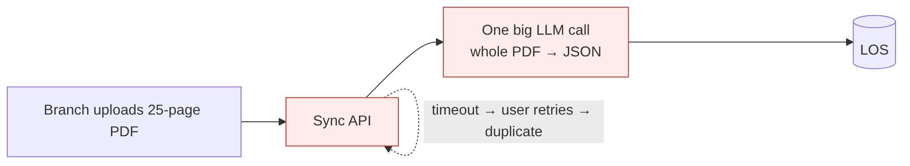
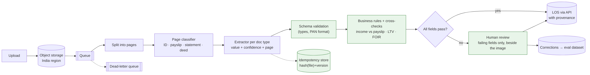

# Ep 5 — Design a Loan Document Processing System (OCR → Structured Data)

**Release:** Wed 11 Nov 2026
**Interview question:** *"Design a system that extracts data from 100,000 scanned loan pages a day."*
**Northwind demand:** Meera (Retail Lending): "A home-loan file takes 6 days because people retype data from 25 scanned pages into the LOS. I want it in one day, and I can't afford a wrong income figure."

## Requirements

| Type | Requirement |
| --- | --- |
| Functional | Ingest PDFs/images (scans, photos, digital PDFs); classify each page (ID, payslip, bank statement, sale deed…); extract ~40 fields to a JSON schema; validate; send low-confidence fields to human review; write to the LOS |
| Non-functional | 100,000 pages/day within a 10-hour window; end-to-end < 4 h per application (vs 6 days); no lost or duplicated files |
| AI-specific | Field-level accuracy ≥ 98% on auto-accepted fields; **every value traceable to a page**; no invented values |
| Compliance | PII (PAN, Aadhaar) masked where not needed; Aadhaar numbers stored only in permitted, masked form; data stays in India |

## Estimates

| Quantity | Value | Working |
| --- | --- | --- |
| Throughput | ~2.8 pages/s | 100,000 ÷ 36,000 s |
| Workers | ~6 steady, 15–20 for peaks/retries | at ~2 s/page per worker |
| Applications/day | ~4,000 | 25 pages each |
| Storage | ~100 GB/day of images | ~1 MB/page; tier to cold storage after 90 days |
| Cost/page | Compare OCR + small LLM vs a vision LLM on 200 real pages | Price both; choose per document type |

## v1 → break it

A synchronous API: upload → one big LLM call with the whole PDF → JSON → LOS.

| Failure | Root cause |
| --- | --- |
| 200-page files time out; the user retries; two records are created | Synchronous call; no idempotency |
| The model "reads" a payslip it couldn't see and invents ₹92,000 | No provenance, no cross-checks; the model fills gaps |
| PAN with a Cyrillic "З" passes into the LOS | No schema validation |
| A bad batch silently corrupts 300 records | No human checkpoint, no confidence routing |

## v2 — asynchronous, verifiable pipeline

1. **Upload → object storage → event → queue.** The API returns a job ID immediately; no long-running HTTP.
2. **Page-level fan-out:** split files into pages; classify each page (a cheap model) so each extractor sees only relevant pages.
3. **Extract per document type** with structured output (JSON schema): value + confidence + **source page/bbox** for every field.
4. **Validate:** schema (types, formats like PAN), then **business rules and cross-checks** (form income vs payslip vs bank-statement credits; LTV and FOIR from POL-CRD-212).
5. **Route:** all fields pass → auto-accept; else a **human review queue showing only the failing fields** beside the source image.
6. **Idempotency:** key = hash(file) + pipeline version; upserts; a dead-letter queue for poison files.
7. **Write to the LOS** through its API with the extraction provenance attached; the audit log keeps model version + reviewer.
8. **Feedback loop:** reviewer corrections become labelled data for evaluating prompts and models.

## OCR + LLM or vision model?

| | OCR + text LLM | Vision LLM |
| --- | --- | --- |
| Strengths | Cheap, mature for typed text; text is reusable for search | Handles layout, stamps, handwriting, tables in one step |
| Weaknesses | Layout and tables lost; poor handwriting | Higher cost per page; harder to get word-level provenance |
| Use for | Digital PDFs, typed forms | Photos, poor scans, complex layouts |

Decide **per document type** using field-level accuracy on ~200 real labelled pages.

## Trade-offs

| Decision | Chosen | Alternative | Why |
| --- | --- | --- | --- |
| Interaction | Async jobs + queue | Sync API | Long files, retries, back-pressure |
| Granularity | Page-level fan-out | Whole-file prompt | Parallelism, smaller prompts, provenance |
| Trust | Rules + cross-checks + confidence | Trust model confidence alone | Models are confidently wrong (LN-1003) |
| Human review | Field-level, exception-only | Review every file | Reviewers spend time only where it matters |
| Retries | Idempotency keys + DLQ | At-least-once without keys | No duplicate loan records |

## Demo
`python demo/extraction_pipeline.py`: three loan files. One clean (auto-accepted); one blurry (PAN fails validation); one where the model invented a payslip figure that **passed the confidence threshold** but was caught by the income cross-check. Then a retry storm that doesn't create duplicates.

## Interviewer follow-ups — model answers

**1. OCR+LLM or a vision model?** Decide per document type by field-level accuracy and cost on a labelled sample. Typed digital PDFs: text extraction + a small LLM is cheaper and gives exact provenance. Photos, stamps, handwriting and complex tables: a vision model is usually worth the cost. Keep the interface identical so you can switch.

**2. How do you measure extraction accuracy?** Field-level precision and recall against human-labelled ground truth: exact match for IDs, tolerance for amounts, normalised match for names. Report per field and per document type, plus the **straight-through rate** (share auto-accepted) and the **error rate among auto-accepted fields**. That last number is the one risk cares about.

**3. Handwriting?** Route handwritten pages (detected by the classifier) to a vision model with a lower auto-accept threshold, and accept a higher human-review share. Don't promise straight-through processing on handwriting.

**4. Reprocessing after a model upgrade?** Version the pipeline; the idempotency key includes the version, so reprocessing creates a new extraction alongside the old one. Compare on the labelled set, then re-run only open applications. Never overwrite reviewer-confirmed values.

**5. PII redaction?** Mask Aadhaar to the last 4 digits at extraction time, store the full image in an access-controlled bucket, and send models only the pages and fields they need. Logs carry field names and confidence, not values.

## Design challenge
Where exactly does human review sit, and what confidence threshold triggers it? Propose thresholds per field type (ID numbers, amounts, names, dates) and explain how you'd tune them with data.
