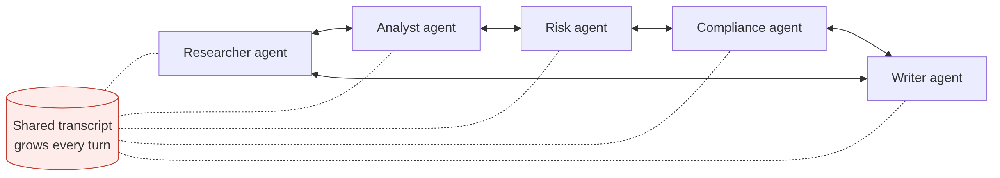
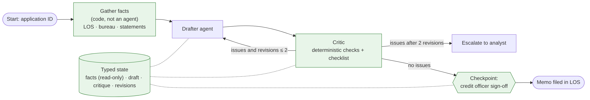

# Ep 7 — Multi-Agent Systems: When They Win, When They're a Trap

**Release:** Sun 15 Nov 2026
**Interview question:** *"Design a multi-agent system that drafts credit memos for home loans."*
**Northwind demand:** The credit team saw a demo: "a researcher agent, an analyst agent, a risk agent, a compliance agent and a writer agent collaborate on the credit memo." They want it in production. Arjun asks what it'll cost; Karen (audit) asks how she'll know which agent said what.

## The honest framing
Multi-agent systems are a **design pattern, not a goal**. Every extra agent adds tokens, latency, failure modes and audit complexity. Use more than one agent only when it buys something concrete: **separation of concerns** (different tools/permissions), **parallelism**, or an **independent check** (critic).

## Patterns

| Pattern | Shape | Good for | Watch out |
| --- | --- | --- | --- |
| Single agent + tools | One loop | Most tasks | Tool overload past ~15 tools |
| Pipeline / workflow | Fixed sequence of steps | Known processes (memos, reports) | Rigid, but predictable |
| Orchestrator–workers | Planner fans out to specialists | Parallel research across sources | Planner errors cascade |
| Generator–critic | Draft → review → revise (capped) | Quality & compliance checks | Endless loops without a cap |
| Free-form "crew" chat | Agents message each other | Brainstorming demos | Cost explosion, non-reproducible, hard to audit |

## Requirements

| Type | Requirement |
| --- | --- |
| Functional | Draft a credit memo from LOS, bureau and bank-statement data; check it against credit policy; route to a credit officer |
| Quality | Every number traceable to a source system; policy checks cite sections; reproducible: the same inputs give the same memo structure |
| Non-functional | < 2 min per memo; cost < ₹10 per memo (illustrative budget) |
| Audit | Per-step record: which node, inputs, outputs, model version |

## Estimates
~4,000 applications/day. Free-form five-agent crew: assumed 5 agents × 4 turns × ~6k-token shared transcript ≈ **120k tokens/memo**. Graph with one drafter + one critic, max 2 revisions: **~14k tokens/memo**, ≈ **8.6× less**. At the mid tier ($1 in/$4 out per 1M, illustrative) that's roughly ₹11–12 vs ₹1.4 per memo, and the graph is also faster and reproducible.

## v1 → break it

| Failure | Root cause |
| --- | --- |
| Cost ~8× budget | Every agent re-reads the whole growing transcript |
| Risk agent "corrects" the income to a different number | Agents pass prose, not typed facts; numbers drift |
| Two runs on the same file give different recommendations | Free-form turn-taking is non-deterministic |
| Audit can't reconstruct who decided what | No per-step state, no checkpoints |

## v2 — a graph, not a chat

1. **Deterministic gathering**: calling three known APIs is code, not an agent.
2. **Typed shared state** (facts, draft, critique, revisions); numbers live in `facts`, sourced from systems of record, and models can't overwrite them.
3. **One drafter + one critic**; the critic combines **deterministic checks** (numbers match facts, citations present) with a model checklist.
4. **Retry cap** (2), then escalate to a human analyst.
5. **Checkpointing**: pause for credit-officer sign-off; resume later; full state history for audit.
6. **Parallelism only where it pays**: e.g. bureau and bank-statement analysis as parallel branches if they are slow.

## Trade-offs

| Decision | Chosen | Alternative | Why |
| --- | --- | --- | --- |
| Topology | Explicit graph | Free-form agent chat | Cost, reproducibility, audit |
| Number of agents | 2 (drafter, critic) | 5 role-play agents | Each extra agent must earn its tokens |
| State | Typed object, facts read-only | Shared transcript | No number drift; smaller prompts |
| Loop control | Retry cap + escalation | "Until the critic is happy" | Bounded cost and latency |
| Human role | Sign-off node with checkpoint | Post-hoc review | Accountability before the decision |

## Demo
`python demo/credit_memo_graph.py` (needs `pip install langgraph`): the critic rejects the first draft (missing policy citations), the second passes, the run pauses at the sign-off checkpoint, a credit officer approves, the run resumes. Prints tokens vs the five-agent assumption.

## Interviewer follow-ups — model answers

**1. When is multi-agent justified?** When agents need different tools or permissions (separation of duties), when work can run in parallel, or when an independent critic measurably improves quality. Prove it on the golden set: if a single agent with the same tools scores the same, ship the single agent.

**2. How do agents share state?** Through a typed state object owned by the orchestrator, not by passing transcripts. Facts from systems of record are read-only; agents write only to their own fields (draft, critique). That keeps prompts small and numbers consistent.

**3. How do you debug a multi-agent run?** Trace every node: inputs, outputs, model version, tokens, latency (OpenTelemetry/Langfuse, Ep 10). Checkpoints let you replay from any step with a different prompt or model, and turn production failures into regression tests.

**4. How do you make output reproducible?** Fixed topology, temperature 0 where possible, pinned model versions, deterministic data gathering, a structured output schema for the memo, and checkpoints. You won't get byte-identical text, but you get identical structure and decisions.

**5. How do you cap cost?** Fewer agents, typed state instead of transcripts, retry caps, smaller models for the critic's routine checks, and per-task budgets enforced by the gateway. Alert on tokens-per-memo drift.

## Design challenge
Take a five-agent "research crew" (planner, web researcher, analyst, writer, reviewer) that writes a weekly market note. Redesign it as the **smallest system that still works**, and say what you removed and why.
