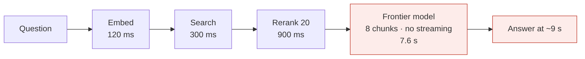
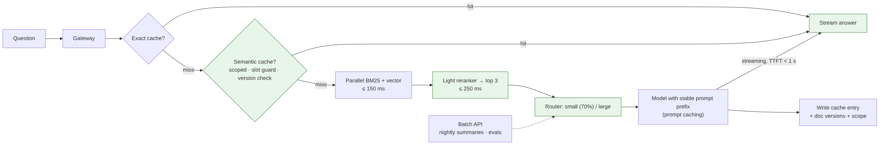

# Ep 8 — Make It Fast and Cheap: Caching, Batching, Streaming, Self-Hosting

**Release:** Wed 18 Nov 2026
**Interview question:** *"Your LLM bill tripled and p95 latency is 9 seconds. Fix it."*
**Northwind demand:** Arjun: "Usage tripled after the HR rollout. The bill is up 3×, branch staff say the bot 'thinks forever', and Finance wants a plan by Friday."

## Step 1: measure before fixing, with a latency budget

| Stage | Measured p95 (before) | Budget (target) |
| --- | --- | --- |
| Gateway + auth | 60 ms | 50 ms |
| Embed query | 120 ms | 50 ms |
| Hybrid search | 300 ms | 150 ms |
| Rerank (20 chunks) | 900 ms | 250 ms |
| LLM time to first token | 2.4 s | 1.0 s |
| Generation (500 tokens, no streaming) | 5.2 s | streamed; user sees text from TTFT |
| **User-perceived** | **~9 s** | **< 2 s to first text** |

*(Illustrative measurements; the method is the point.)* Users judge speed by **time to first token (TTFT)**, so streaming alone changes perception dramatically.

## Step 2: where the money goes
Input tokens dominate (2,850 in vs 300 out per question). Levers, roughly in order of impact for Northwind:

1. **Routing** (Ep 4): 70% of questions to the small tier → ~3× cheaper
2. **Fewer, better chunks:** rerank 20 → 3 instead of sending 8 → −40% input tokens
3. **Prompt caching** (provider feature): keep the system prompt + instructions as a **stable prefix** so repeated prefixes are billed at a discount and processed faster. Check your provider's rules and pricing
4. **Semantic/exact caching** for repeated FAQ-style questions (safely: see below)
5. **Output discipline:** a concise answer format and max_tokens; structured output
6. **Batch APIs** for non-interactive work (nightly summaries, evals): providers typically discount batch jobs
7. **Self-hosting** (vLLM, quantised open models) when volume is high and steady (Ep 4 break-even)

## The semantic cache, done safely

A semantic cache returns a stored answer when a new question is "similar enough". It's a big win for FAQs and a big risk in a bank:

| Risk | Example | Guard |
| --- | --- | --- |
| **Personal data leak** | "What's my balance?" served from another user's cache | Never cache personal/session-specific questions; scope keys by user or entity |
| **Near-miss with a different answer** | "LTV up to 30 lakh" vs "LTV above 75 lakh": very similar vectors, different answers | Slot guard: numbers and business qualifiers must match exactly; a threshold tuned for **zero wrong hits** |
| **Stale answer** | Policy updated to v4; the cache serves the v3 answer | Store source doc versions with each entry; invalidate on change events (Ep 3) |
| **Permission leak** | An HR-only answer cached and served to all staff | Include the ACL scope in the cache key |

## v1 → break it → v2

 

v2 request path: gateway → **exact cache** → **semantic cache (scoped, slot-guarded, versioned)** → retrieval (parallel BM25 + vector) → **light reranker** on top 20 → **routed model** with a stable prompt prefix → **streamed** response. Offline: batch jobs for summaries and evals.

## Self-hosting checklist (if the break-even says yes)
vLLM or TGI with continuous batching · quantisation (AWQ/GPTQ/FP8) after checking quality on the golden set · autoscale on queue depth and GPU utilisation · keep a minimum warm replica (cold starts take minutes) · route overflow to an API · watch **tokens/s per GPU** and cost per 1M tokens.

## Trade-offs

| Decision | Chosen | Alternative | Why |
| --- | --- | --- | --- |
| Perceived latency | Streaming + TTFT budget | Faster model only | Biggest UX gain for least cost |
| Cache | Exact + scoped semantic with slot guard | Plain semantic cache | Plain caches leak data and confuse near-misses |
| Context | Rerank to 3 chunks | Send 8–10 | Fewer tokens, often better answers |
| Batch | Batch API for offline jobs | Real-time calls | Cheaper; nobody is waiting |
| Self-host | Only past break-even | "Open models are free" | GPUs and engineers aren't |

## Demo
`python demo/semantic_cache.py`: labelled question pairs show that a near-miss ("above 75 lakh") can score **higher** than a true paraphrase. A threshold alone gives wrong hits; the slot guard removes them. Then the personal-question scope rule and version-based invalidation.

## Interviewer follow-ups — model answers

**1. When is semantic caching dangerous?** When answers depend on the user (balances, eligibility), on numbers or qualifiers inside the question, on permissions, or on fast-changing sources. Mitigate with scope keys, slot guards, version-tagged entries, conservative thresholds tuned on labelled pairs, and by measuring the wrong-hit rate in production samples.

**2. TTFT vs total latency?** TTFT is when the user first sees text; total latency is when the answer is complete. For chat, optimise TTFT (streaming, smaller prompts, prompt caching, fast routing). For APIs feeding other systems, total latency and throughput matter more.

**3. When does self-hosting pay off?** When steady volume keeps GPUs busy, data must stay in-network, or you need a tuned open model. Compute GPU + ops cost per million tokens at realistic utilisation and compare to API prices. Include headroom and on-call.

**4. What does batching cost you?** Latency: the request waits for the batch window or for the batch job (often hours for provider batch APIs). Use it for offline work. Inside self-hosted servers, continuous batching raises throughput at a small per-request latency cost.

**5. How do you cut tokens without losing quality?** Rerank and send fewer chunks; trim conversation history (summarise older turns); remove boilerplate from the system prompt; ask for concise structured outputs; route easy questions to small models. Verify every change on the golden set (Ep 10).

## Design challenge
Cut p95 from 9 s to under 3 s (and first text under 1 s). Show your latency budget per stage and the cost impact of each change.
