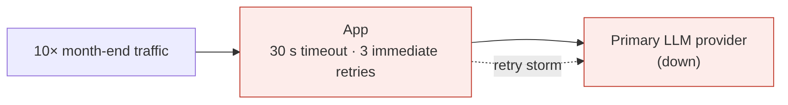
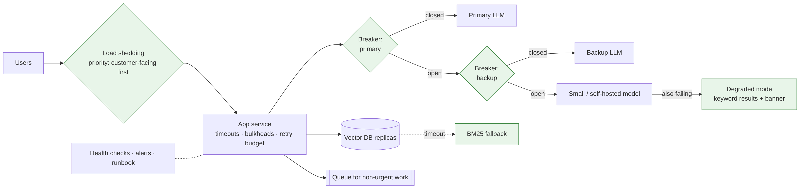

# Ep 9 — Make It Survive Month-End: Reliability and Failover for AI Systems

**Release:** Sat 21 Nov 2026
**Interview question:** *"The LLM provider went down during peak. What happens to your system?"*
**Northwind demand:** Month-end, 10:40 AM. Traffic ×10. The primary LLM provider starts timing out. Branches can't answer customers, the contact-centre agent stalls mid-call, and retries make everything worse. Priya: "This can never happen again at month-end."

## Failure-mode table (do this in every design)

| Component | Failure | Symptom | Mitigation |
| --- | --- | --- | --- |
| LLM provider | Outage, slowness, 429 rate limits | Hanging requests, errors | Timeouts, circuit breaker, fallback provider, queueing |
| Vector DB | Node loss, slow queries | Retrieval timeouts | Replicas, timeouts, **keyword-search fallback** |
| Embedding service | Down | Can't embed queries | Fallback to BM25-only retrieval |
| Tools (core banking via MCP) | Slow/down | Agent stalls | Per-tool timeouts, bulkheads, "can't do that right now" path |
| Cache (Redis) | Down | Higher latency/cost | Fail open to the normal path |
| Gateway / app | Pod crash, bad deploy | 5xx | Multiple replicas, health checks, canary + rollback |
| Region | Cloud region issue | Total outage | Multi-region active-passive, respecting data residency |

## Estimates: availability math

Serial chain: gateway 99.95% × app 99.9% × vector DB 99.9% × LLM 99.5% ≈ **99.25%** → ~5.5 h downtime/month.
Add a second LLM provider (independent failures): LLM layer ≈ 99.9975% → system ≈ **99.75%** (~1.8 h/month). The LLM was the weakest link; the next one is the vector DB, so replicate it and add a keyword fallback.

Capacity: month-end ×10 on 0.45 QPS average peak → ~4.5 QPS sustained, bursts to ~20 QPS. Check **provider rate limits** (requests/min and tokens/min) against the burst: 20 QPS × 3,150 tokens ≈ 63k tokens/s ≈ **3.8M tokens/min**. Rate limits, not servers, are usually the first wall.

## v1 → break it

| Failure | Root cause |
| --- | --- |
| Users wait 2 minutes, then see an error | 30 s timeouts × 3 immediate retries |
| The outage gets *worse* | Retry storm: every client retries at once, so the provider throttles harder (429) |
| Everything is down although only one dependency failed | No fallback; synchronous chain |
| Recovery takes 20 min after the provider is back | Queues full of stale retries; no probe-based recovery |

## v2 — designed to degrade, not die

1. **Timeouts everywhere**, sized from the latency budget (e.g. 8 s for the model, 300 ms for search).
2. **Retries only for retryable errors** (timeouts, 5xx, 429 with Retry-After), with **exponential backoff + jitter** and a retry *budget* (≤ 10% extra traffic).
3. **Circuit breaker per provider/deployment:** after N failures, open (stop calling it), then send half-open probes and close on success.
4. **Fallback chain:** backup provider → smaller model → **degraded mode** (keyword search results + "AI answers are delayed" banner) → queue the request for later.
5. **Bulkheads:** separate connection pools and rate limits per use case, so the batch summariser can't starve the contact-centre agent.
6. **Load shedding and priority:** at saturation, protect customer-facing traffic; defer internal FAQs.
7. **Async for non-urgent work:** queue-based load levelling for summaries and document jobs.
8. **Idempotency** for every write tool (Ep 5/6) so that retries never double-act.
9. **Health checks, canaries, multi-region** active-passive (India and US stacks stay in-region).
10. **Runbooks + game days:** practise the provider-outage drill before month-end.

## Trade-offs

| Decision | Chosen | Alternative | Why |
| --- | --- | --- | --- |
| Retries | Budgeted, backoff + jitter | Immediate retries | Avoid retry storms |
| Failing dependency | Circuit breaker | Keep trying | Fast failure, fast recovery |
| Last resort | Degraded mode (search results) | Error page | Staff can still find the policy |
| Second provider | Yes, for customer-facing paths | Single vendor | Weakest link in the availability chain |
| Multi-region | Active-passive per residency zone | Active-active | Cost and data residency; RTO of minutes is acceptable |

## Demo
`python demo/resilience_sim.py`: the same 10-minute month-end burst with a 4-minute provider outage under three designs. Naive retries: p95 **120 s**, ~700 errors, 6,000+ calls hammering the dead provider. Backoff + fallback: errors almost gone, but p95 ~31 s. **Circuit breaker:** p95 **~3 s**, zero errors, and the breaker's open → probe → close transitions printed.

## Interviewer follow-ups — model answers

**1. Which errors should you retry?** Timeouts, connection errors, 5xx, and 429 when the server gives a Retry-After. Never retry 4xx validation/auth errors, or non-idempotent writes without an idempotency key. For LLMs, also don't retry a *content* failure (bad JSON) with the same prompt; repair or re-prompt instead.

**2. How do you avoid retry storms?** Exponential backoff with jitter, a cap on attempts, a retry budget per client (e.g. 10% of traffic), honouring Retry-After, and circuit breakers so that clients stop calling a dead dependency.

**3. What does degraded mode look like for an AI feature?** It returns something useful without the LLM: the top keyword-search results with links, a cached answer for very common questions, or "your request is queued, we'll notify you". Make it a designed, tested product state, not an accident.

**4. How do you load-test an LLM app?** Replay realistic prompts (sizes matter) at target QPS against a staging gateway with **mocked or rate-limit-aware** providers; measure p95 TTFT, errors and token throughput. Separately confirm the provider rate-limit tiers. Run chaos tests: kill the provider, slow the vector DB.

**5. Active-active or active-passive?** For Northwind, active-passive per residency zone: cheaper, simpler data consistency, and an RTO of minutes is acceptable. Active-active only when the business case justifies the cost and the data model supports it.

## Design challenge
Every LLM provider is down for 30 minutes at month-end. Design the degraded experience for (a) branch staff using the policy bot and (b) the contact-centre agent, and what happens to queued requests when providers recover.
