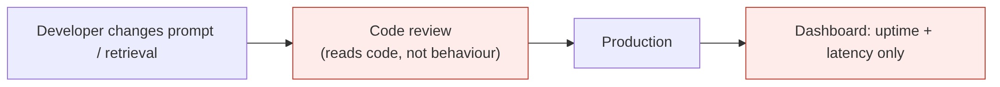
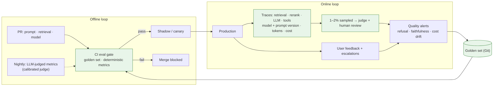

# Ep 10 — Evals and Observability: Proving Your AI System Works

**Release:** Sun 22 Nov 2026
**Interview question:** *"How do you know your RAG answers are correct in production?"*
**Northwind demand:** Karen (internal audit): "Before the regulator's inspection I need evidence that the policy bot is accurate, that it doesn't leak, and that last month's prompt change didn't make it worse. 'It looked fine in the demo' is not evidence."

## Two loops

```
OFFLINE (before deploy)                     ONLINE (after deploy)
golden set → run pipeline → metrics         traces → sampled human review → user feedback
        → threshold gate in CI ──deploy──►  → drift alerts → new failures added to golden set ─┐
        ▲                                                                                      │
        └──────────────────────────────────────────────────────────────────────────────────────┘
```

## What to measure

| Layer | Metric | How |
| --- | --- | --- |
| Retrieval | Context recall / precision @k | Expected source sections in the golden set |
| Answer | Correctness | Required facts present (deterministic) or LLM-judge vs reference |
| Answer | Faithfulness / groundedness | Every claim supported by the retrieved context (judge, or extractive check) |
| Safety | Refusal on unanswerable; ACL leak rate (= 0); injection resistance | Dedicated golden items |
| Ops | TTFT, p95, tokens & cost per answer, error/fallback rate | Traces + metrics |
| Users | Thumbs up/down, escalations to the policy desk, re-asks | Product analytics |

## The golden set
Start with **50–100 real questions** from pilot users and the policy desk, each with expected source sections, required facts, and labels (answerable / unanswerable / restricted). Grow it from production failures every week. Version it in Git; it is a product asset. See [`northwind/golden_set.json`](../northwind/golden_set.json).

## LLM-as-judge, honestly
Judges are useful for open-ended quality but are themselves models: **calibrate** them against ~100 human-labelled examples, measure agreement, pin the judge model version, and use deterministic checks wherever possible (facts present, citations valid, ACL respected). Tools: Ragas, DeepEval, promptfoo, TruLens, MLflow evaluate.

## Estimates
- Golden set: 100 items × (2,850 in + 300 out) tokens ≈ 315k tokens ≈ **$0.06 (small) to $1.30 (frontier) per full run** at illustrative prices; LLM-judge calls roughly double it. Cheap enough for every PR on deterministic metrics, nightly for judged metrics.
- Online review: sample 1–2% of traffic (~100–200 answers/day at Northwind volume) for weekly human review.

## v1 → break it



| Failure | What happened |
| --- | --- |
| A "simplified retrieval" PR quietly removed the version and ACL filters | No automated gate; reviewers read code, not behaviour |
| The judge rated hallucinated answers 5/5 | Uncalibrated LLM judge |
| "Why was this answer slow?" Nobody knew | No per-step traces |
| Metrics dashboards looked green during a policy-version incident | Only latency/error metrics; no quality signals |

## v2 — eval-driven development + observability



1. **Golden set in Git**, owned jointly by engineering and the policy desk.
2. **CI eval gate** on every PR touching prompts, retrieval, chunking or model config: deterministic metrics block merges; judged metrics run nightly.
3. **Shadow / canary** for model changes (Ep 4), compared on the same metrics.
4. **Tracing:** one trace per request with spans for retrieval, rerank, LLM, tools; attributes for model version, prompt version, tokens, cost, chunk IDs (OpenTelemetry → Langfuse / Arize Phoenix / your APM).
5. **Online evaluation:** sampled answers scored by the judge + weekly human review; user feedback joined to traces.
6. **Alerts on quality, not just uptime:** refusal-rate spikes, faithfulness drops, cost per answer drifting.
7. **Close the loop:** every confirmed failure becomes a golden item.

## Trade-offs

| Decision | Chosen | Alternative | Why |
| --- | --- | --- | --- |
| Gate metrics | Deterministic first, judged second | Judge everything | Stable, cheap, explainable CI |
| Judge | Calibrated, pinned version | Any strong model | Judges drift and disagree with humans |
| Review | Sampled human review weekly | Review everything / nothing | Coverage at a sustainable cost |
| Traces | Full spans, redacted payloads | Logs only | Debuggability without storing PII |

## Demo
```
python demo/eval_gate.py --config release      # all metrics pass → exit 0
python demo/eval_gate.py --config regression   # "simplified retrieval" → refusal & ACL-leak fail → exit 1
```
`demo/github-actions-eval-gate.yml` wires the gate into CI; traces are written to `eval_traces.jsonl` for upload.

## Interviewer follow-ups — model answers

**1. How do you build the first golden set?** Mine real questions from the pilot and the helpdesk; have domain experts write expected sources and facts; add unanswerable, restricted and adversarial items deliberately. Start with 50 and grow weekly from production failures. Quality beats size.

**2. Can you trust an LLM judge?** Only after calibration: measure its agreement with human labels, fix the rubric, pin the model version, and re-check when either changes. Prefer deterministic checks for anything checkable (facts, citations, permissions).

**3. Which metrics go on the dashboard?** For leadership: answer correctness (sampled), escalation rate, cost per answer, p95 TTFT. For engineers: per-stage latency, retrieval recall on canaries, refusal rate, fallback rate, tokens per request. For risk/audit: ACL-leak tests, injection test pass rate, incidents.

**4. How do you catch drift?** Track metric distributions over time: refusal rate, average retrieval scores, answer length, topic mix, judge scores. Alert on change points. Re-run the golden set nightly against production config to catch provider-side model changes.

**5. Who owns the evals?** The product team owns the pipeline and gate; domain experts own the expected answers; risk/audit own the safety tests and thresholds. Make it a RACI, or it decays.

## Design challenge
Write 10 golden questions for Northwind's policy bot, including 2 unanswerable, 2 restricted (HR-only) and 1 prompt-injection attempt, each with expected sources and required facts. Submit them as a PR to `northwind/golden_set.json`.
