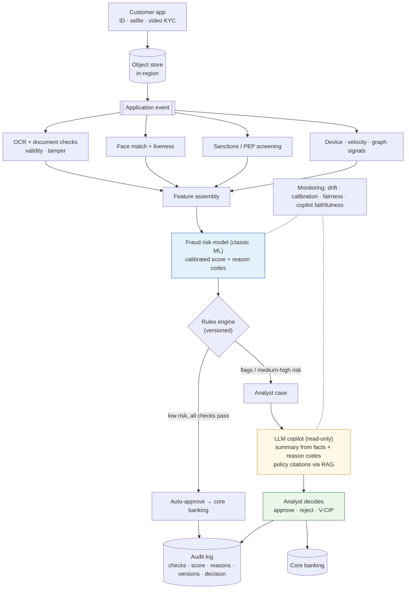

# Ep 12 — Capstone: Design a KYC and Fraud Copilot (Live Mock Interview)

**Release:** Sat 28 Nov 2026
**Interview question:** *"Design an AI-assisted KYC and fraud review system for a bank onboarding 15,000 customers a day."*
**Northwind demand:** Priya: "Digital onboarding is growing 40% a year. KYC analysts are drowning: 9,000 cases a day in the review queue, synthetic-identity fraud is rising, and the regulator expects every decision to be explainable."

This README is the **reference answer**, structured with the 9-step playbook from Ep 1. The episode itself is a timed mock interview: see [mock_interview.md](mock_interview.md).

## 1 · Clarify
- Users: KYC analysts (India + US), fraud investigators, compliance reviewers. Customers are affected but don't use the copilot.
- Scope: retail onboarding (account opening). Out of scope: transaction monitoring (a separate AML system).
- "Good": fewer frauds onboarded, faster legitimate onboarding, every decision explainable and auditable; **humans decide** on flagged cases.

## 2 · Requirements

| Type | Requirement |
| --- | --- |
| Functional | Capture ID + selfie (+ video KYC); OCR and document checks; face match + liveness; sanctions/PEP screening; fraud risk score with reason codes; analyst case view with an AI case summary; decision + audit |
| Non-functional | Auto-decision path < 60 s; analyst case load time < 2 s; 99.9% availability during onboarding hours; burst ×3 at campaign launches |
| AI-specific | Risk model calibrated and validated; LLM summaries grounded only in case facts; no protected-attribute inference; drift monitoring |
| Compliance | KYC rules (officially valid documents, V-CIP rules), sanctions screening, DPDP Act (India) and US privacy rules; model risk management; data residency per entity; retention schedules |

## 3 · Estimates

| Quantity | Value |
| --- | --- |
| Applications | 15,000/day → peak ~2 per second at campaign bursts |
| Straight-through (low risk, all checks pass) | assume 60% → 9,000 auto-approved |
| Analyst review queue | ~40% → 6,000 cases/day (down from 9,000 today with better triage) |
| Analyst time | 12 min → **5 min** per case with pre-filled checks + AI summary → 6,000 × 5 min = 500 analyst-hours/day (≈ 63 analysts on 8-hour shifts) |
| LLM summaries | 6,000/day × (3,000 in + 300 out) ≈ **$0.0042/case on the mid tier ≈ $25/day** (illustrative) |
| Images | 15,000 × ~3 MB (ID front/back + selfie) ≈ 45 GB/day; tiered storage, retention per policy |

## 4 · High-level design

## 5 · Deep dive: the decision engine and the copilot
- **Deterministic checks first:** document validity (format, expiry, MRZ/QR), tamper detection, face match + liveness (vendor or in-house CV), sanctions/PEP screening (fuzzy matching → analyst on any potential hit).
- **Fraud risk model (classic ML, e.g. gradient boosting or logistic regression):** features like device reuse across accounts, velocity, address mismatch, tamper score, behavioural signals. Calibrated probabilities + reason codes (SHAP/coefficients). **The LLM is not the fraud model**: it can't be calibrated or validated the same way.
- **Policy/rules engine:** combines check results and the risk band into auto-approve / analyst review / reject-with-review, versioned and testable.
- **LLM copilot (analyst-facing only):** summarises the case from structured facts and reason codes, cites policy sections (RAG over KYC policy, Ep 2–3), proposes next verification steps. It **never** decides, never sees more PII than needed, and writes nothing to the core system.
- **Graph signals** (shared devices, phone numbers, addresses across applications) to catch synthetic-identity rings; investigators get a graph view.

## 6 · Data flow (one application)
Capture → object store (in-region) → event → checks run in parallel (OCR/doc, face/liveness, screening, device/velocity) → feature assembly → risk model → rules → auto-approve **or** case created → analyst opens case → copilot summary generated (gateway, redacted inputs) → analyst decides → decision + evidence + versions to the audit log → core banking account creation.

## 7 · Scale, reliability, security
- Parallel checks with timeouts; vendor fallbacks for OCR/face; degraded mode routes to analysts rather than auto-rejecting (Ep 9).
- Idempotent application IDs; queue-based processing (Ep 5).
- Least privilege: the copilot has read-only access to the case; PII redaction before any external model; India/US separation (Ep 3, 11).
- Prompt-injection surface: uploaded documents can contain text, so OCR text is treated as untrusted data (Ep 6, 11).

## 8 · Evals & monitoring
- **Risk model:** AUC/precision at operating threshold, calibration, false-positive rate by segment, stability (PSI) and drift; champion-challenger; independent model validation.
- **Copilot:** faithfulness to case facts (deterministic check that every number appears in the facts), analyst usefulness ratings, time-per-case; golden set of past cases (Ep 10).
- **Fairness:** monitor outcomes by permitted proxies and geography; no protected attributes as features; document the analysis.
- **Business:** fraud loss rate, onboarding conversion, straight-through rate, analyst throughput, SLA breaches.

## 9 · Trade-offs

| Decision | Chosen | Alternative | Why |
| --- | --- | --- | --- |
| Fraud scoring | Classic ML + rules | LLM decides | Calibration, validation, explainability, cost |
| LLM role | Analyst copilot (summaries, next steps) | Customer-facing decisions | Human accountability; lower risk tier |
| Checks | Parallel with timeouts | Sequential | Latency under 60 s |
| Uncertain cases | Route to analyst | Auto-reject | Customer fairness, regulatory expectations |
| Vendors | Abstracted behind interfaces with fallbacks | Single vendor hard-wired | Resilience and negotiating power |

## Demo
`python demo/case_copilot.py`: a logistic-regression fraud model on synthetic data (AUC printed), a high-risk case with reason codes, and the grounded LLM prompt that turns those facts into an analyst summary.
